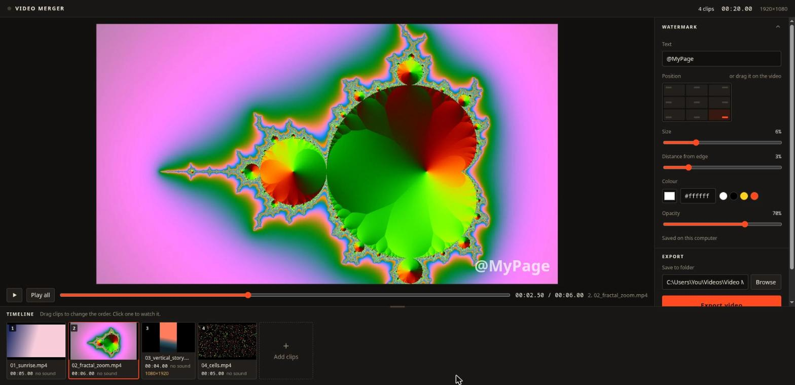

# Video Merger

Join short clips into one video and add your text watermark. Opens in your browser, works offline.

## Download

Get the latest version from [Releases](../../releases/latest).

- **Windows:** download `VideoMerger-Windows.zip`, unzip it, double-click `VideoMerger.exe`.
- **Linux:** download `VideoMerger-Linux.tar.gz`, unpack it, run `VideoMerger`. Needs `ffmpeg` installed.

## How to use

1. Drag your clips into the page.
2. Drag them in the timeline to set the order.
3. Set up your watermark once. It is saved for next time.
4. Click **Export video**.

Close the browser tab when you are done. The app stops by itself.

> On first launch Windows may say "Windows protected your PC". Click **More info**, then **Run anyway**.

## License

[MIT](LICENSE). Font: Noto Sans ([OFL](web/FONT-LICENSE.txt)). The Windows download includes [FFmpeg](https://ffmpeg.org), which has its own licence (included in the zip).
